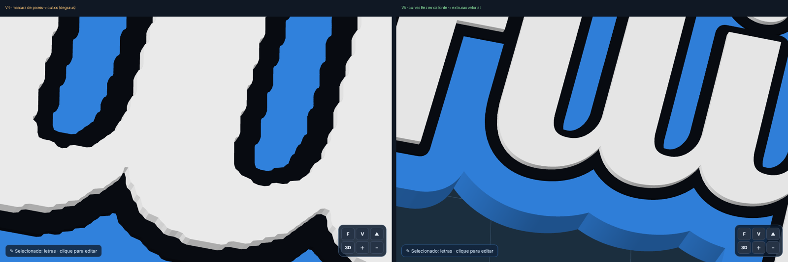

# SparrowTech 3D Studio

Editor visual open source para criar nomes, porta-chaves, placas e outros modelos 3D personalizáveis, com foco em edição direta e impressão 3D multicolor.

> **Estado:** protótipo em desenvolvimento (v5). A geometria das letras já é vetorial e a malha exportada é verificada como fechada; a importação do 3MF no Bambu Studio e no Creality Print ainda tem de ser confirmada nas aplicações. Não é uma aplicação validada para produção nem para impressão sequencial segura.

## Usar

Descarrega [`dist/sparrowtech_3d_studio_v5.html`](dist/sparrowtech_3d_studio_v5.html) e abre-o no Chrome, Edge ou Firefox. Funciona sem internet: bibliotecas e fontes estão embutidas.

Escreve o nome, escolhe a fonte e carrega em **🖨 Imprimir**: sai um 3MF pronto para o Bambu Studio / Creality Print. A argola fica numa posição segura e reforçada; se a arrastares para um sítio frágil, a app avisa. Opções de impressora, bico, camadas e cópias estão em **⚙ Pro (beta)**.

| Rato | Ação |
|---|---|
| Esquerdo + arrastar | rodar |
| **Esquerdo + direito + arrastar** (ou só direito, roda premida, Shift + esquerdo) | deslocar a vista |
| Roda | zoom no cursor |
| Ctrl + arrastar (separador Impressão) | mover a peça no tabuleiro |
| Clique | editar letras / base / argola |
| **Clique nas letras + roda** | trocar de fonte (Esc para voltar ao zoom) |



## Desenvolvimento

```bash
npm run build          # dist/sparrowtech_3d_studio_v5.html a partir de src/, vendor/ e fonts/
npm test               # testes de geometria e 3MF (Node 18+)
npm run test:browser   # testes no Chrome headless (playwright)
```

Documentação: [arquitetura V5](docs/ARQUITETURA-V5.md) · [cores no 3MF](docs/3MF-CORES.md) · [testes](docs/TESTES.md).

## Visão

Escrever um nome, comparar fontes manuscritas em pré-visualização, editar diretamente a peça com o rato e preparar a impressão no tabuleiro da impressora, sem menus desnecessários.

## Funcionalidades previstas

- **Easy / Profissional:** edição simples por clique e ferramentas avançadas opcionais.
- **Fontes:** galeria com o próprio nome em cada fonte; importação de TTF/OTF; letras ligadas e curvas suaves.
- **Base:** contorno que segue a silhueta do texto, nuvem, retângulo/tablet, cantos arredondados, oval ou sem base.
- **Edição:** clicar nas letras, base ou argola abre as respetivas propriedades; mover/redimensionar com rato; atualização instantânea.
- **Argola:** colocação automática numa zona estruturalmente válida, tamanho padrão ajustável, reposicionamento por arrastar.
- **Frente/verso:** verso liso ou com texto, gravação, relevo, preenchimento e efeitos vazados; navegação e foco corretos.
- **Cores:** partes independentes para base, contorno e letras; exportação 3MF com cores/componentes e transformações.
- **Impressoras:** Bambu A1, Bambu A1 Mini e Creality K1C; limites reais do tabuleiro, margens, encaixe e distribuição de peças.
- **Impressão:** STL/3MF, validação de malha, visualização de colisões e aviso para impressão sequencial por objeto.

## Prioridades

1. ~~Corrigir as letras «Minecraft»~~ — feito na v5: extrusão das curvas vetoriais da fonte.
2. Separação de cores no 3MF — v5 exporta partes por filamento no formato Bambu/Orca/Creality; **falta confirmar nos slicers**.
3. ~~Zoom sob o cursor, foco na peça, pan com esquerdo + direito~~ — feito na v5.
4. Argola automática e regras de robustez de peças pequenas.
5. Testar os perfis de impressora e a disposição de múltiplas peças.

Ver [requisitos](docs/REQUISITOS.md) e [plano de desenvolvimento](docs/ROADMAP.md).

## Compatibilidade

Destinos de teste: **Bambu Studio** e **Creality Print**. Qualquer exportação deve ser conferida no slicer antes de imprimir; a colocação de peças no tabuleiro não equivale à validação de segurança da impressão sequencial.

## Contribuições e licença

O projeto pretende ser gratuito e open source, incluindo utilização comercial dos objetos originais criados. As condições concretas para redistribuição do código devem constar num ficheiro `LICENSE` antes da publicação de uma versão estável. Fontes, modelos e outros recursos de terceiros mantêm as respetivas licenças.

Dependências embutidas: opentype.js (MIT), Clipper JS 6.4.2 (Boost Software License; inclui jsbn, licença BSD), earcut (ISC). Fontes embutidas: Lobster, Lobster Two, Pacifico, Courgette, Kaushan Script e Great Vibes — todas SIL Open Font License 1.1 (ver `fonts/`). A versão antiga em `legacy/` embute também Z003 (URW++), cuja licença deve ser confirmada antes de redistribuir.
